## **Git config**

### **Configure Git**

**User Name** : Your name will be attached to your commits. Set it with:


```python
git config --global user.name "Your Name"
```

**Email Address** : Your email is also attached to your commits. Set it with:


```python
git config --global user.email "Your Email Address"
```

Set the default branch name for new repositories (for example, main instead of master):


```python
git config --global init.defaultBranch main
```

**more examples**


```python
# Global Ignore File
# Create a global ignore file with:

touch .gitignore
git config --global core.excludesfile ~/.gitignore

# Global Editor
# Set your default editor with:

git config --global core.editor nano

# Open the global config file where you can change configuration manually
git config --global --edit
```

### **Viewing Your Configuration**

You can see all your Git settings with:


```python
git config --list
# user.name=Your Name
# user.email=you@example.com
# core.editor=code --wait
# alias.st=status
# init.defaultbranch=main

# Shows all Git settings along with the file they come from
git config -l --show-origin  
```

To view a specific value, use:


```python
git config user.name
# Your Name
```

### **Changing or Unsetting Config Values**

- To change a value, just run the ``git config`` command again with the new value.
- To remove a setting, use --unset:


```python
git config --global --unset code.editor
```

### **Configuration Levels**

There are three levels of configuration:
 - System (all users): ``git config --system``
 - Global (current user): ``git config --global``
 - Local (current repo): ``git config --local``


```python
# Example: Set a Local Config
# Local settings only apply to the current repository

git config user.name "Project Name"

# Example: Set a Global Config
# Global settings apply to all repositories for the current user.

git config --global user.name "Global Name"

# Example: Set a System Config
# System settings apply to all repositories for all users.

git config --system user.name "System Name"
```

## **What is a Repository?**
 - A Git repository is a folder that Git tracks for changes.
 - The repository stores all your project's history and versions.


```python
# mkdir creates a new directory.
# cd changes our working directory.

mkdir myproject
cd myproject

# Now that we are in the correct folder, we can initialize Git on that folder:

git init 
# Initialized empty Git repository in /Users/user/myproject/.git/
```

- Git creates a hidden folder called .git inside your project. 
- This is where Git stores all the information it needs to track your files and history.

### **What is an Untracked File?**
 - An untracked file is any file in your project folder that Git is not yet tracking.
 - These are files you've created or copied into the project folder, but haven't told Git to watch.
 - To make a file tracked, you need to add it to the staging area.


```python
# Check if Git is tracking your new file:

git status
# On branch master
# No commits yet
# Untracked files:
#   (use "git add ..." to include in what will be committed)
#     index.html
# nothing added to commit but untracked files present (use "git add" to track)
```

 - Git sees index.html, but it is untracked (not yet added to the repository)

## **What is the Staging Environment?**
 - The staging environment (staging area or the Index) is like a waiting room for your changes.
 - You use it to tell Git exactly which files you want to include in your next commit.


```python
git add <file>  # -> Stage a file
git add --all # -> Stage all changes or "git add -A" 
git status # -> See what is staged
git restore --staged <file> # -> Unstage a file
```

## **Git Commit**
 - A commit is like a save point in your project.
 - It records a snapshot of your files at a certain time, with a message describing what changed.
 - You can always go back to a previous commit if you need to.


### **How to Commit with a Message (-m)**

To save your staged changes, use git commit -m "your message":


```python
git commit -m "First release of Hello World!"
# [master (root-commit) 221ec6e] First release of Hello World!
#  3 files changed, 26 insertions(+)
#  create mode 100644 README.md
#  create mode 100644 bluestyle.css
#  create mode 100644 index.html
```

### **Commit All Changes Without Staging (-a)**

- You can skip the staging step for already tracked files with git commit -a -m "message".
- This commits all modified and deleted files, but not new/untracked files.


```python
git commit -a -m "Quick update to README"
# [master 123abcd] Quick update to README
#  1 file changed, 2 insertions(+)
```

### **Write Multi-line Commit Messages**

- If you just type git commit (no -m), your default editor will open so you can write a detailed, multi-line message:


```python
git commit
```

### **Other Useful Commit Options**

- Create an empty commit:


```python
git commit --allow-empty -m "Start project"
```

- Use previous commit message (no editor):


```python
git commit --no-edit
```

- Quickly add staged changes to last commit, keep message:


```python
git commit --amend --no-edit
```

- Forgot to stage a file?
    - If you run ``git commit -m "message"`` but forgot to ``git add`` a file, just add it and commit again. Or use ``git commit --amend`` to add it to your last commit.


```python
git add forgotten.txt
git commit --amend
```

- Remove Files from Last Commit


```python
git reset HEAD^ -- unwanted.txt
git commit --amend
```

### **View Commit History (git log)**

- To view the history of commits for a repository, you can use the git log command:


```python
git log
# commit 09f4acd3f8836b7f6fc44ad9e012f82faf861803 (HEAD -> master)
# Author: w3schools-test 
# Date:   Fri Mar 26 09:35:54 2021 +0100
#     Updated index.html with a new line
# commit 221ec6e10aeedbfd02b85264087cd9adc18e4b26
# Author: w3schools-test 
# Date:   Fri Mar 26 09:13:07 2021 +0100
#     First release of Hello World!

# To display commits after sha1 to sha2 (included)
git log sha1..sha2
```

- For a shorter view, use git log --oneline:


```python
git log --oneline
# 09f4acd Updated index.html with a new line
# 221ec6e First release of Hello World!

# -> you can display specified number of commit
git log --oneline -4
```

- To see which files changed in each commit, use ``git log --stat``:


```python
git log --stat
```

## **Git Tag**
 - A tag in Git is like a label or bookmark for a specific commit.
 - Tags are most often used to mark important points in your project history, like releases (v1.0 or v2.0).
 

### **Lightweight Tag** 
- Just a simple name for a commit (no extra info, like a bookmark).


```python
git tag <tagname> # -> Create a lightweight tag, example : git tag v1.0
```

### **Annotated Tag**
- Stores author, date, and message. 
- Recommended for releases and sharing with others.


```python
git tag -a <tagname> -m "message" #-> Create an annotated tag,
# example : git tag -a v1.0 -m "Version 1.0 release"
```

### **Tag a Specific Commit**

- You can tag an older commit by specifying its hash :


```python
git tag v1.1 1a2b3c4d
```

### **List Tags**

- List Tags in your repository:


```python
git tag
```

### **Show Tag Details (git show)**

- See details about a tag and the commit it points to :


```python
git show v1.0
```

### **Push Tags to Remote**

- To push a single tag to your remote repository :


```python
git push origin v1.0
```

- To push all your local tags to the remote at once : 


```python
git push --tags
```

### **Delete Tags**

- Delete a tag locally :


```python
git tag -d v1.0
```

- Delete a tag from the remote repository :


```python
git push origin --delete tag v1.0
```

### **Update or Replace a Tag (Force Push)**

- If you need to move a tag to a different commit and update the remote :


```python
git tag -f v1.0 <new-commit-hash>
git push --force origin v1.0
```

## **Git Stash**

 - Sometimes you need to quickly switch tasks or fix a bug, but you're not ready to commit your work. "git stash" lets you save your uncommitted changes and return to a clean working directory. You can come back and restore your changes later.

- Here are some common use cases:
    - **Switch branches safely:** Save your work before changing branches.
    - **Handle emergencies:** Stash your work to fix something urgent, then restore it.
    - **Keep your work-in-progress safe:** Avoid messy commits or losing changes.

### **Stash Your Changes (git stash)**

Save your current changes : 
 - Tracked files (both staged and unstaged) are stashed by default.
 - Untracked files (new files not yet added to Git) are not stashed by default.
 - To stash untracked files too, use "git stash -u" (or --include-untracked).


```python
git stash
# Saved working directory and index state WIP on main: 1234567 Add new feature
```

- Your changes are now saved in a stack.

- **What is a stash stack?**
    - Each time you run git stash, your changes are saved on top of a "stack".
    - The most recent stash is on top, and you can apply or drop stashes from the top down, or pick a specific one from the list.

### **Stash with a Message (git stash push -m)**

- Add a message to remember what you stashed:


```python
git stash push -m "WIP: homepage redesign"
# Saved working directory and index state On main: WIP: homepage redesign
```

### **List All Stashes (git stash list)**

- List All Stashes saved : 


```python
git stash list
# stash@{0}: On main: WIP: homepage redesign
# stash@{1}: WIP on main: 1234567 Add new feature
```

### **Show Stash Details**
- This command gives a summary of what files and changes are in your most recent stash.


```python
git stash show
# src/index.html | 2 +-
# 1 file changed, 1 insertion(+), 1 deletion(-)
```

- This command shows the exact lines that were changed in your most recent stash.


```python
git stash show -p
# diff --git a/src/index.html b/src/index.html
# index 1234567..89abcde 100644
# --- a/src/index.html
# +++ b/src/index.html
# @@ ...
```

### **Apply the Latest Stash ``git stash apply``**
- This command restores your most recent stashed changes, but keeps the stash in the list so you can use it again if needed.


```python
git stash apply
# On branch main
# Changes not staged for commit:
#   (use "git add ..." to update what will be committed)
#   (use "git restore ..." to discard changes in working directory)
#     modified:   src/index.html
```

### **Apply a Specific Stash `git stash apply stash@{n}`**
- restore a specific stash from the list.


```python
git stash apply stash@{1}
# On branch main
# Changes not staged for commit:
#     modified:   src/index.html
```

### **Pop the Stash ``git stash pop``**
- Apply the latest stash and remove it from the stack.


```python
git stash pop
# On branch main
# Changes not staged for commit:
#     modified:   src/index.html
# Dropped refs/stash@{0} (abc1234d5678)
```

### **Drop a Stash ``git stash drop``**
- Delete a specific stash when you no longer need it.


```python
git stash drop stash@{0}
# Dropped stash@{0} (abc1234d5678)
```

### **Clear All Stashes ``git stash clear``**
- Delete all your stashes at once. 


```python
git stash clear
```

### **Branch from a Stash ``git stash branch``**
- Create a new branch and apply a stash to it.
- Useful if your stashed work should become its own feature branch


```python
git stash branch new-feature stash@{0}
# Switched to a new branch 'new-feature'
# On branch new-feature
# Changes not staged for commit:
#     modified:   src/index.html
# Dropped stash@{0} (abc1234d5678)
```

**Note:** Stashes are useful for temporary work, but are not a replacement for commits!

## **Git History**
- Git keeps a detailed record of every change made to your project.
- You can use history commands to see what changed, when, and who made the change.

### **See Commit History (git log)**
- This command shows all commits, including author, date, and message.
- Use the arrow keys to scroll
- press q to quit.
- you can search for a word by typing "/" followed by your search term, then press "n" to jump to the next match.


```python
git log
# commit 09f4acd3f8836b7f6fc44ad9e012f82faf861803 (HEAD -> master)
# Author: w3schools-test 
# Date:   Fri Mar 26 09:35:54 2021 +0100

#     Updated index.html with a new line
```

### **Show Commit Details (git show <commit>)**
- This command shows everything about a specific commit: 
    - who made it, when, the message, and the exact changes.


```python
git show 09f4acd
# commit 09f4acd3f8836b7f6fc44ad9e012f82faf861803 (HEAD -> master)
# Author: w3schools-test 
# Date:   Fri Mar 26 09:35:54 2021 +0100

#     Updated index.html with a new line

# diff --git a/index.html b/index.html
# index 1234567..89abcde 100644
# --- a/index.html
# +++ b/index.html
# @@ ...
# +New Title
```

### **Compare Changes (git diff)**
- See what is different between your working directory (unstaged changes) and the last commit.


```python
git diff
# diff --git a/index.html b/index.html
# index 1234567..89abcde 100644
# --- a/index.html
# +++ b/index.html
# @@ ...
# -Old Title
# +New Title
```

### **Compare Staged Changes (git diff --staged)**
- See what is different between your staged files and the last commit.


```python
git diff --staged
# diff --git a/index.html b/index.html
# index 1234567..89abcde 100644
# --- a/index.html
# +++ b/index.html
# @@ ...
# -Old Title
# +New Title
```

### **Compare Two Commits (git diff "commit1" "commit2")**
- See what changed between any two commits.


```python
git diff 1234567 89abcde
# diff --git a/index.html b/index.html
# index 1234567..89abcde 100644
# --- a/index.html
# +++ b/index.html
# @@ ...
# -Old Title
# +New Title
```

### **Compare Two branches**


```python
git diff branchName01..branchName02
```

### **Show a Summary of Commits (git log --oneline)**


```python
git log --oneline
# 09f4acd Updated index.html with a new line
# 8e7b2c1 Add about page
# 1a2b3c4 Initial commit
```

### **Show Commits by Author (git log --author="Alice")**


```python
git log --author="Alice"
# commit 1a2b3c4d5e6f7g8h9i0j
# Author: Alice 
# Date:   Mon Mar 22 10:12:34 2021 +0100

#     Add about page
```

### **Show commits using priods of time**
- ``git log --since dd/mm/yyyy`` : from "dd/mm/yyyy" till now.
- ``git log -- until dd/mm/yyyy`` : before "dd/mm/yyyy".


```python
git log --since="2 weeks ago"
# commit 09f4acd3f8836b7f6fc44ad9e012f82faf861803
# Author: w3schools-test 
# Date:   Fri Mar 26 09:35:54 2021 +0100

#     Updated index.html with a new line
```

### **Show Files Changed Per Commit (git log --stat)**
- See which files were changed in each commit and how many lines were added or removed.


```python
git log --stat
# commit 09f4acd3f8836b7f6fc44ad9e012f82faf861803
# Author: w3schools-test 
# Date:   Fri Mar 26 09:35:54 2021 +0100

#     Updated index.html with a new line

# index.html | 2 +-
# 1 file changed, 1 insertion(+), 1 deletion(-)
```

### **Show a Branch Graph (git log --graph)**
- See a simple ASCII graph of your branch history (great for visualizing merges).


```python
git log --graph --oneline
# * 09f4acd Updated index.html with a new line
# * 8e7b2c1 Add about page
# |\
# | * aabbccd Merge branch 'feature-x'
# |/
```

## **Git Help**
- If you forget how a command works or want to learn about its options, you can use Git's built-in help.


```python
git help <command> # -> See the manual page for a command
git <command> --help # -> See help for a command (same as above)
git <command> -h # -> See a quick summary of options
git help --all # -> List all possible Git commands
git help -g # -> List guides and concepts
```

## **Git Branch**
- In Git, a branch is like a separate workspace where you can make changes and try new ideas without affecting the main project. Think of it as a "parallel universe" for your code.
- Common Reasons to Create a Branch :
    - Developing a new feature.
    - Fixing a bug.
    - Experimenting with ideas.

### **Creating a New Branch**


```python
git branch hello-world-images
```

### **Listing All Branches**


```python
git branch
#   hello-world-images
# * master
```

- the "*" beside master specifies that we are currently on that branch.

### **Switching Between Branches**


```python
git checkout hello-world-images
# Switched to branch 'hello-world-images'

git switch branch-name
# Switched to branch 'branch-name'
```

**Note :** Using the "-b" option on "checkout" will create a new branch, and move to it.


```python
git checkout -b emergency-fix
# Switched to a new branch 'emergency-fix'
```

### **Deleting a Branch**


```python
git branch -d hello-world-images # -> if it's already merged.
git branch -D branch-name # -> force delete an unmerged branch.
```

### **Rename a branch**


```python
git branch -m old-name new-name
```

### **Protected Branches**
- Some branches (like main) may be protected, meaning you cannot **delete** or **force-push** to them without special permissions (this rules are applied to remote branches only).

## **Merging in Git**
- Merging in Git means combining the changes from one branch into another.

### **Merging Branches (git merge)**
- you first switch to the branch you want to merge into (often **main** or **master**), then run the merge command with the branch name you want to combine in.


```python
git merge emergency-fix
# Updating 09f4acd..dfa79db
# Fast-forward
#  index.html | 2 +-
#  1 file changed, 1 insertion(+), 1 deletion(-)
```

- Since the emergency-fix branch came directly from master, and no other changes had been made to master while we were working, Git sees this as a continuation of master. So it can "Fast-forward", just pointing both master and emergency-fix to the same commit.

### **Practical Notes**
- **Abort a merge:** ``git merge --abort``
- **Check status during a merge:** ``git status``
- **Resolve a conflict and complete the merge:** Edit the conflicted file(s), then ``git add`` file and ``git commit``.
- **Fast-forward merge:** Happens when no new commits diverged—Git just moves the branch pointer forward.
- **No-fast-forward merge:** Use git ``merge --no-ff branchname`` to always create a merge commit, preserving branch history.

### **Squash Merge (git merge --squash)**
- If you want to combine all the changes from a branch into a single commit (instead of keeping every commit).


```python
git merge --squash feature-branch
# Squash commit -- not updating HEAD
# Automatic merge went well; stopped before committing as requested
```

### **What is a Merge Conflict?**
- A merge conflict happens when changes in two branches touch the same part of a file and Git doesn't know which version to keep.

- How to Resolve a Merge Conflict :
    - Git will mark the conflict in your file.
    - You need to open the file, look for lines like "<<<<<<< HEAD" and "=======", and decide what the final version should be.
    - Then, stage and commit your changes.

**Merge Conflict Example**
- Add another image file (img_hello_git.jpg) and change "index.html", so it shows it:


```python
<!DOCTYPE html>
<html>
<head>
<title>Hello World!</title>
<link rel="stylesheet" href="bluestyle.css">
</head>
<body>

<h1>Hello world!</h1>
<div></div>
<p>This is the first file in my new Git Repo.</p>
<p>A new line in our file!</p>
<div></div>

</body>
</html>
```


```python
git add --all
git commit -m "added new image"
# [hello-world-images 1f1584e] added new image
#  2 files changed, 1 insertion(+)
#  create mode 100644 img_hello_git.jpg
```


```python
git checkout master
git merge hello-world-images
# Auto-merging index.html
# CONFLICT (content): Merge conflict in index.html
# Automatic merge failed; fix conflicts and then commit the result.
```

- The merge failed, as there is conflict between the versions for "index.html".


```python
git status
# On branch master
# You have unmerged paths.
#   (fix conflicts and run "git commit")
#   (use "git merge --abort" to abort the merge)

# Changes to be committed:
#         new file:   img_hello_git.jpg
#         new file:   img_hello_world.jpg

# Unmerged paths:
#   (use "git add ..." to mark resolution)
#         both modified:   index.html
```


```python
<!DOCTYPE html>
<html>
<head>
<title>Hello World!</title>
<link rel="stylesheet" href="bluestyle.css">
</head>
<body>

<h1>Hello world!</h1>
<div></div>
<p>This is the first file in my new Git Repo.</p>
<<<<<<< HEAD
<p>This line is here to show how merging works.</p>
=======
<p>A new line in our file!</p>
<div></div>
>>>>>>> hello-world-images

</body>
</html>
```

- We can see the differences between the versions and edit it like we want:


```python
<!DOCTYPE html>
<html>
<head>
<title>Hello World!</title>
<link rel="stylesheet" href="bluestyle.css">
</head>
<body>

<h1>Hello world!</h1>
<div></div>
<p>This is the first file in my new Git Repo.</p>
<p>This line is here to show how merging works.</p>
<div></div>

</body>
</html>
```


```python
git add index.html
git status
# On branch master
# All conflicts fixed but you are still merging.
#   (use "git commit" to conclude merge)

# Changes to be committed:
#         new file:   img_hello_git.jpg
#         new file:   img_hello_world.jpg
#         modified:   index.html

git commit -m "merged with hello-world-images after fixing conflicts"
# [master e0b6038] merged with hello-world-images after fixing conflicts

git branch -d hello-world-images
# Deleted branch hello-world-images (was 1f1584e).
```

### **Pick One Side's Changes**


```python
# Keep Our Changes
git checkout --ours filename.txt

# Keep Their Changes
git checkout --theirs filename.txt
```

## **Git Workflow**
- Git uses a distributed workflow that allows you to work on your code, stage changes, and commit them to your local repository before sharing with others.

- The Three Areas of Git : 
    - **Working Directory:** Where you make changes to your files.
    - **Staging Area (Index):** Where you prepare changes before committing.
    - **Repository:** Where your committed history is stored.

### **Undoing and Amending Changes**
- Made a mistake? Git lets you fix things before you push!


```python
git restore <file> # -> Undo changes in your working directory (before staging)
# in another word go to you last commit.
git restore --staged <file> # -> Unstage a file (move it out of the Staging Area).
git reset HEAD~ # -> Undo your last commit (keeps changes in your working directory).
git commit --amend # -> Change the last commit message or add files to your last commit.
# example:
# ---- 
git add utils.js        # stage the missing file
git commit --amend --no-edit
# ----
git commit -m "Fixd login bug"
git commit --amend -m "Your updated message"
```

## **Git Security SSH**

### **What is SSH?**
- SSH (Secure Shell) is a way to connect securely to remote computers and services, like Git repositories.
- SSH uses a pair of keys (public and private) to make sure only you can access your code.

### **First-Time SSH Key Setup**
- Enable the SSH agent on your operating system:


```python
eval $(ssh-agent -s)
```

### **Generating an SSH Key Pair**


```python
ssh-keygen -t rsa -b 4096 -C "your@email.com"
```

### **Adding Your Key to the SSH Agent**


```python
ssh-add ~/.ssh/id_rsa
```

### **Copying Your Public Key**
- Copy your public key and add it to your account settings on GitHub
- On Windows (Git Bash): ``clip < ~/.ssh/id_rsa.pub`` (then copy manually). 

### **Listing and Removing SSH Keys**
- See which keys are loaded in your SSH agent.


```python
ssh-add -l
```

- To remove a key from the agent.


```python
ssh-add -d ~/.ssh/id_rsa
```

### **Set GitHub Remote Origin**
- Test Your SSH Connection :


```python
ssh -T git@github.com
# The authenticity of host 'github.com (140.82.121.3)' can't be established.
# RSA key fingerprint is SHA256:nThbg6kXUpJWGl7E1IGOCspRomTxdCARLviKw6E5SY8.
# Are you sure you want to continue connecting (yes/no/[fingerprint])? yes
# Warning: Permanently added 'github.com,140.82.121.3' (RSA) to the list of known hosts.
# Hi your-username! You've successfully authenticated, 
# but GitHub does not provide shell access.
```

- Get Your Repository's SSH Address from GitHub:
    - semilar to : ``git@github.com:your-username/your-repo.git``

- Add or Update the Remote Origin


```python
git remote add origin git@github.com:your-username/your-repo.git # -> add
git remote set-url origin git@github.com:your-username/your-repo.git # -> update
```

## **Git Pull from GitHub**
- it is used to update our local repository with the most recent changes from GitHub.

### **Git Fetch**
- it downloads new data from a remote repository, but does not change your working files or branches.


```python
git fetch origin
# remote: Enumerating objects: 5, done.
# remote: Counting objects: 100% (5/5), done.
# remote: Compressing objects: 100% (3/3), done.
# remote: Total 3 (delta 2), reused 0 (delta 0), pack-reused 0
# Unpacking objects: 100% (3/3), 733 bytes | 3.00 KiB/s, done.
# From https://github.com/w3schools-test/hello-world
#    e0b6038..d29d69f  master     -> origin/master
```

- Now that we have the recent changes, we can check our status:


```python
git status
# On branch master
# Your branch is behind 'origin/master' by 1 commit, and can be fast-forwarded.
#   (use "git pull" to update your local branch)

# nothing to commit, working tree clean
```

- Double check by viewing the log:


```python
git log origin/master
# commit d29d69ffe2ee9e6df6fa0d313bb0592b50f3b853 (origin/master)
# Author: w3schools-test <77673807+w3schools-test@users.noreply.github.com>
# Date:   Fri Mar 26 14:59:14 2021 +0100

#     Updated README.md with a line about GitHub

# commit e0b6038b1345e50aca8885d8fd322fc0e5765c3b (HEAD -> master)
# Merge: dfa79db 1f1584e
# Author: w3schools-test 
# Date:   Fri Mar 26 12:42:56 2021 +0100

#     merged with hello-world-images after fixing conflicts
```

- See the differences between our local master and origin/master


```python
git diff origin/master
# diff --git a/README.md b/README.md
# index 23a0122..a980c39 100644
# --- a/README.md
# +++ b/README.md
# @@ -2,6 +2,4 @@
#  Hello World repository for Git tutorial
#  This is an example repository for the Git tutoial on https://www.w3schools.com

# -This repository is built step by step in the tutorial.
# -
# -It now includes steps for GitHub
# +This repository is built step by step in the tutorial.
# \ No newline at end of file
```

### **Git Merge**
- Merge combines the current branch (master) with a specified remote target branch (origin/master) after checking the differences between them (using the data downloaded through fetch).


```python
git merge origin/master
# Updating e0b6038..d29d69f
# Fast-forward
#  README.md | 4 +++-
#  1 file changed, 3 insertions(+), 1 deletion(-)
```

- Check our status again to confirm we are up to date:


```python
git status
# On branch master
# Your branch is up to date with 'origin/master'.

# nothing to commit, working tree clean
```

### **Git Pull**
- ``pull`` is a combination of ``fetch`` and ``merge``.
- It is used to pull all changes from a remote repository into the branch you are working on (resolving conflicts if they exist, then committing the changes).


```python

git pull origin
# remote: Enumerating objects: 5, done.
# remote: Counting objects: 100% (5/5), done.
# remote: Compressing objects: 100% (3/3), done.
# remote: Total 3 (delta 1), reused 0 (delta 0), pack-reused 0
# Unpacking objects: 100% (3/3), 794 bytes | 1024 bytes/s, done.
# From https://github.com/w3schools-test/hello-world
#     a7cdd4b..ab6b4ed  master       -> origin/master
# Updating a7cdd4b..ab6b4ed
# Fast-forward
#   README.md | 2 ++
#   1 file changed, 2 insertions(+)
```

## **Git Push to GitHub**
- When we have made changes locally, we want to update our remote repository with the changes.

### **Basic Push**
- This will upload your local commits to GitHub.


```python
# check remote repository

git remote -v
# origin  https://github.com/w3schools-test/hello-world.git (fetch)
# origin  https://github.com/w3schools-test/hello-world.git (push)

# push to remote repository

git push origin master # -> or just "git push origin"
```

### **Force Push**
- If your push is rejected due to non-fast-forward updates (for example, after a rebase), you can force the push.
- **Warning:** This can overwrite changes on the remote repository. Use with caution!

- **Example:**
    - Local ``master`` has commits A → B → C
    - Remote ``feature-branch`` had commits X → Y
    - After this push, ``feature-branch`` on the remote will be A → B → C (the X → Y history is replaced).


```python
# you are telling Git:
# “Take my local branch (the one I am currently on) and 
# overwrite the remote branch named feature-branch on origin.”

git checkout master
git push --force origin master:feature-branch

# or when both branches have the same name 
# it leaad to a simlirar effect as the previous,
# since it replaces the remote branch with your local history.

git push --force origin feature-branch
```

- **safer force push:** 
    - Git checks that the remote branch has not been updated since you last fetched it.
    - If someone else pushed new commits to feature-branch in the meantime, 
    - the push will fail instead of overwriting their work.


```python
git push --force-with-lease origin feature-branch
```

### **Push Tags**


```python
git push --tags # -> To push all local tags to GitHub
git push origin v1.0 # -> To push a specific tag
```

### **Troubleshooting**
- if someone else pushed commits to your shared remote branch since your last pull, Git will reject the push to prevent overwriting others’ work.
- You would see something like: ``! [rejected]        main -> main (fetch first)``


```python
# Solution : performs a pull from a remote branch,
# but instead of merging the changes, 
# it rebases your local commits on top of the fetched commits.

git pull --rebase
git push
```

## **Pull a Branch from GitHub**
- use the "-a" option to see all local and remote branches.
- use ``branch -r`` is for remote branches only.


```python
git branch -a
# * master
#   remotes/origin/html-skeleton
#   remotes/origin/master
```

- We see that the branch html-skeleton is available remotely, but not on our local git. Lets check it out:


```python
git checkout html-skeleton
# Switched to a new branch 'html-skeleton'
# Branch 'html-skeleton' set up to track remote branch 'html-skeleton' from 'origin'.

git pull
# Already up to date.
```

## **Push Branch to GitHub**


```python
git checkout -b update-readme
git push origin update-readme
```

### **Push and Set Upstream**
- **The benefit:** after this, you can run ``git push`` or ``git pull`` without specifying remote branch, Git knows which one to use.


```python
git push --set-upstream origin update-readme
# -> or just "git push -u origin update-readme"
```

### **Delete Remote Branch**


```python
git push origin --delete update-readme
```

### **Push All Branches**


```python
git push --all origin
```

## **Workflows**

### **Git Flow**

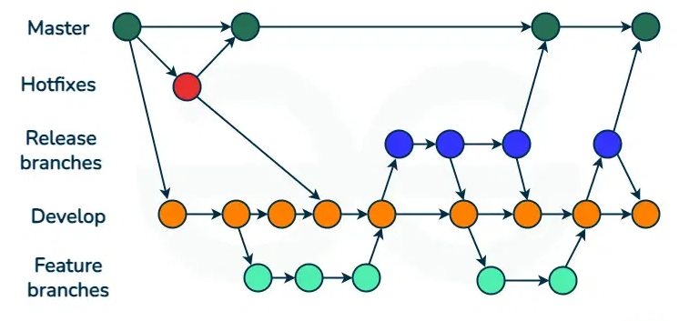

### **GitHub Flow**

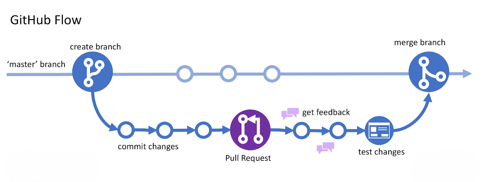

## **GitHub Pages**

- GitHub Pages lets you publish a website directly from your repository. To enable it:
    - Create a new repository named ``your-username.github.io``.
    - Add your website files (like index.html) to the repository.
    - Push your changes to GitHub.
- You can choose which branch and folder to publish. By default, GitHub uses **main** (or **master**) and the **root** folder.
-  your site will be available at ``https://your-username.github.io/`` (or your custom domain).

## **Git Contribute**

### **Fork a Repository**
- A fork is a copy of a repository.

### **Clone from GitHub**
- A clone is a full copy of a repository to your local machine, including all logging and versions of files.


```python
# copy repo from GitHub to new folder named "w3schools-test.github.io"
git clone https://github.com/w3schools-test/w3schools-test.github.io.git

# or -> copy repo from GitHub to a specific folder path
git clone https://github.com/w3schools-test/w3schools-test.github.io.git <path>
```

### **Configuring Remotes**
- Let's see how the ``remotes`` of this Git is set up after cloning by default:


```python
git remote -v
# origin  https://github.com/w3schools-test/w3schools-test.github.io.git (fetch)
# origin  https://github.com/w3schools-test/w3schools-test.github.io.git (push)

# Get detailed information about a specific remote
git remote show upstream
```

- Rename the default ``origin`` remote :


```python
git remote rename origin upstream
git remote -v
# upstream        https://github.com/w3schools-test/w3schools-test.github.io.git (fetch)
# upstream        https://github.com/w3schools-test/w3schools-test.github.io.git (push)
```

- Add our fork as ``origin`` : 


```python
git remote add origin https://github.com/kaijim/w3schools-test.github.io.git
git remote -v
# origin  https://github.com/kaijim/w3schools-test.github.io.git (fetch)
# origin  https://github.com/kaijim/w3schools-test.github.io.git (push)
# upstream        https://github.com/w3schools-test/w3schools-test.github.io.git (fetch)
# upstream        https://github.com/w3schools-test/w3schools-test.github.io.git (push)
```

**Note:** According to Git naming conventions, it is recommended to name your own repository ``origin``, and the one you forked for ``upstream``.

- To remove a remote repository


```python
git remote remove upstream
```

### **Send Pull Request**
- link to the chapter : https://www.w3schools.com/git/git_remote_send_pull_request.asp?remote=github

## **Git Revert**
- The ``git revert`` command undoes a previous commit by creating a new commit that reverses the changes.


```python
git revert HEAD # -> Revert the latest commit
git revert <commit> # -> Revert a specific commit
git revert HEAD~2 # -> Revert a commit further back in history
git revert --no-edit # -> Skip commit message editor

# If you get an error message saying "error: could not revert...", try using 
git revert --abort # -> to abort the revert process.
# If you get an error message saying "error: could not apply...", try using 
git revert --continue # -> to continue the revert process.
```

## **Git Reset**
- The git reset command moves your current branch (HEAD) to a different commit.

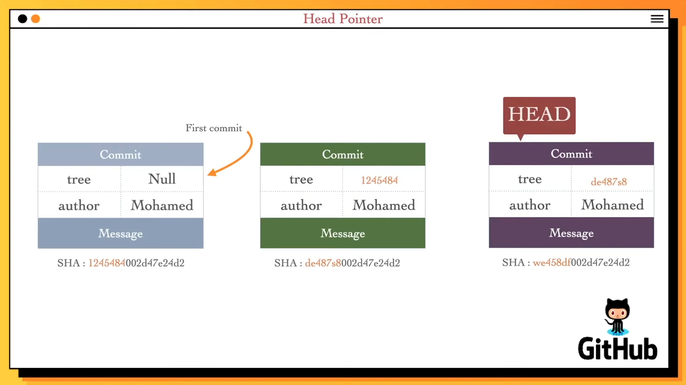

- Rules of thumb
    - ``<rev>~<n>`` goes backward n parents from ``rev``, selecting the first parent each time.
    - Use ``<rev>^<n>`` to select the n-th immediate parent of merge commit ``rev``.

<br>
<pre>
G   H   I   J
 \ /     \ /
  D   E   F
   \  |  / \
    \ | /   |
     \|/    |
      B     C
       \   /
        \ /
         A

A =      = A^0
B = A^   = A^1     = A~1
C = A^2
D = A^^  = A^1^1   = A~2
E = B^2  = A^^2
F = B^3  = A^^3
G = A^^^ = A^1^1^1 = A~3
H = D^2  = B^^2    = A^^^2  = A~2^2
I = F^   = B^3^    = A^^3^
J = F^2  = B^3^2   = A^^3^2
</pre>

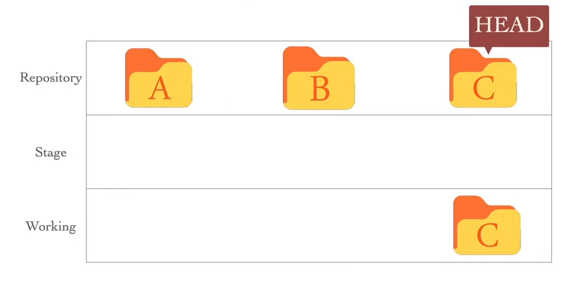

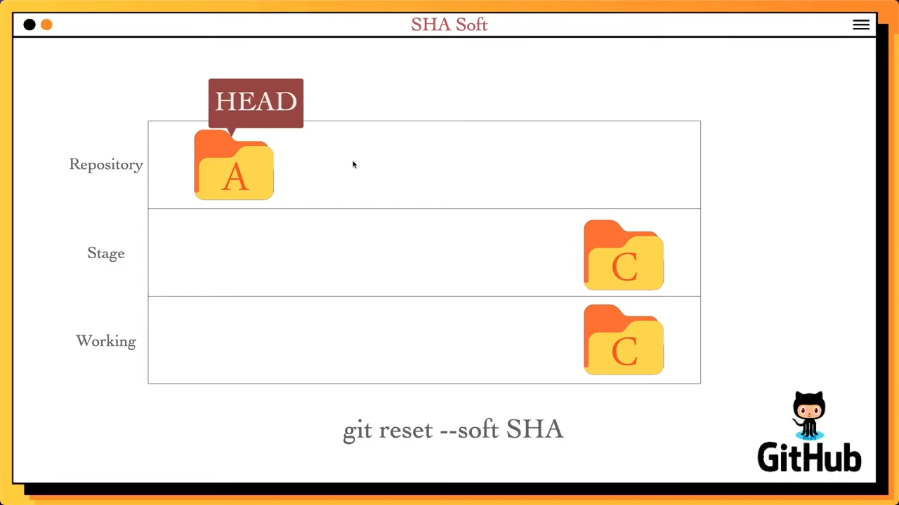

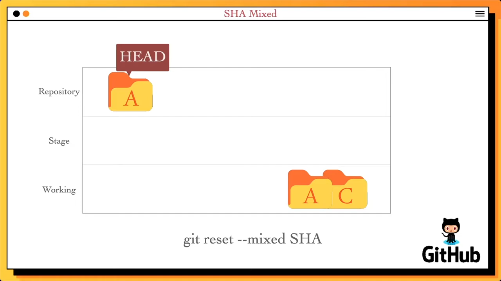

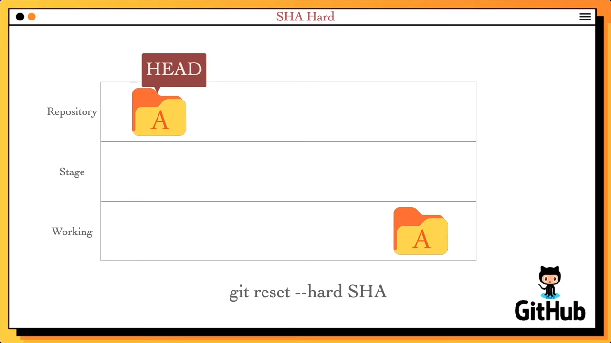


```python
git reset --soft <commit> # -> Move HEAD to commit, keep changes staged
git reset --mixed <commit> # -> Move HEAD to commit, unstage changes (default)
git reset --hard <commit> # -> Move HEAD to commit, discard all changes
git reset <file> # -> Unstage a file
```

- Restore a file (or all files) to how it was in that commit and stage it, without removing later commits from history.

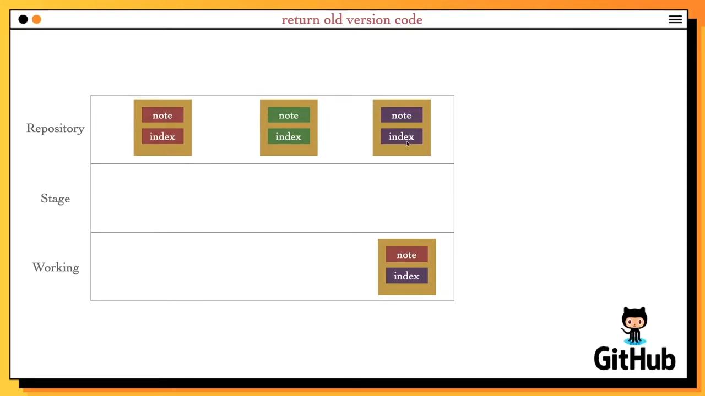


```python
git checkout <sha1> <file>   
```

**parctical example**


```python
git checkout f2a5a3b
# do some changes
git add *
git commit -m "message"
# Head is at 4d6db


```

* If you checkout to the **main** branch, your newly committed branch may be lost unless you remember its commit hash.
* However, it is still possible to recover it using **git reflog**.
* Moreover, Git may garbage-collect it since it is in a **detached HEAD** state.
* Therefore, you need to create a new branch for the new commit to prevent this from happening.


```python
git branch bugfix
```

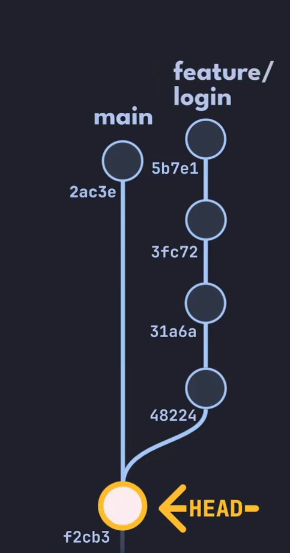
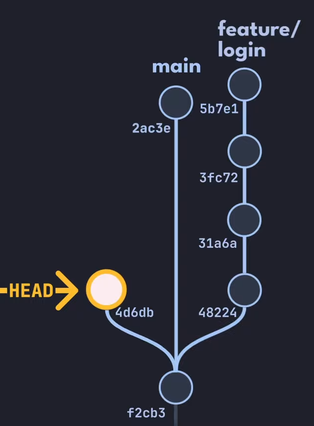
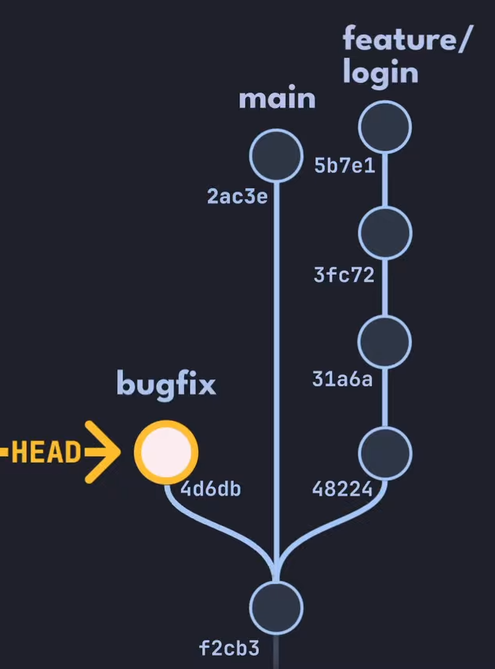

- Unstage changes (for one file or all) while keeping your edits in the working directory


```python
git reset HEAD <file>
```

- Undo file edit from the working directory (based on last commit)


```python
git checkout <file path>
```

### **Revert or Reset?**

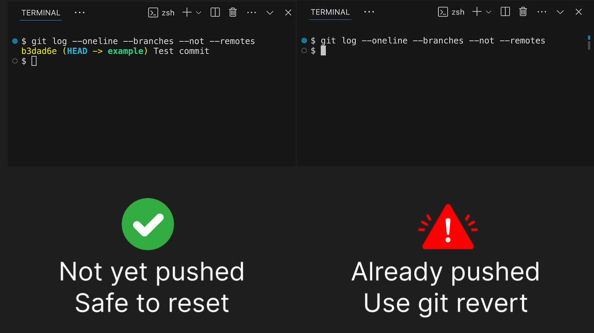


## **Git Rebase**
- Rebasing moves or combines a sequence of commits to a new base commit one by one.

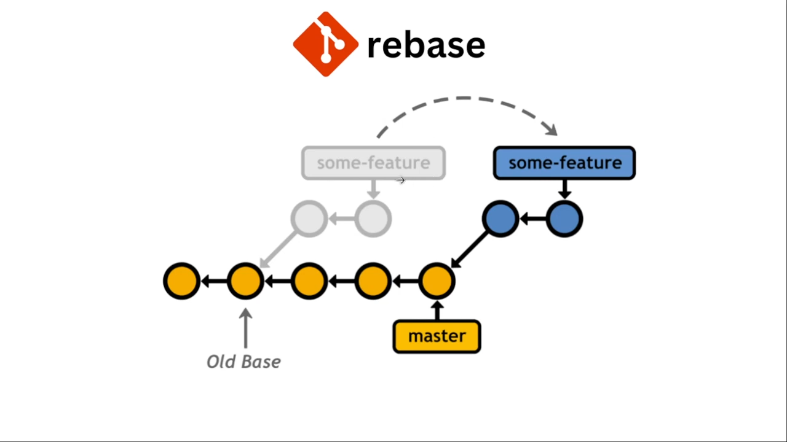

| Feature / Aspect       | git merge                                      | git rebase                                      |
|------------------------|-----------------------------------------------|-------------------------------------------------|
| **History Modification** | Doesn't modify history, only adds to it       | Modifies history (destructive operation)        |
| **Commit Hashes**       | Leaves commit hashes and timestamps alone     | Modifies commit hashes and timestamps*          |
| **History Shape**       | Leaves more commits in history (branchy)      | Results in more linear history                 |
| **Safety with Pushed Commits** | Can safely be used on pushed commits         | Never rebase pushed commits                    |


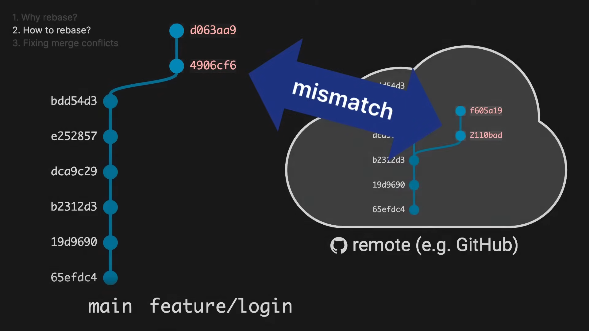

### **Basic Rebase**
- To move your current branch on top of another branch.


```python
git checkout feature-branch
git rebase main
```

### **Interactive Rebase**
- Ways to rewrite history or (iterate over commits):
    - **reword** – change commit message  
    - **edit** – change commit content  
    - **squash** – join multiple commits together  
    - **split** – split a commit into multiple commits (can be simulated using edit)
    - **reorder** – reorder the commit history  
    - **drop** – delete a commit from history
    - ...etc


```python
git rebase -i HEAD~3
```

### **Continue**
- If you hit a conflict or need to finish editing a commit, use ``git rebase --continue`` after resolving the issue.
- This tells Git to keep going with the rebase process.


```python
git add fixed_file.txt
git rebase --continue
```

### **Abort**
- If something goes wrong or you want to stop the rebase, use ``git rebase --abort``.
- This will put your branch back to how it was before you started rebasing.


```python
git rebase --abort
```

### **Skip**
- If you can't fix a commit during a rebase (for example, if a conflict can't be resolved), you can skip it with ``git rebase --skip``.
- Git will leave out that commit and move on to the next one.


```python
git rebase --skip
```

## **Git Reflog**
- ``git reflog`` records updates to the tip of branches and HEAD.
- It is excluded from the remote.
- It is useful for :
    - Recover lost commits.
    - Restore a deleted branch.
    - Undo a reset or a merge.
    - See the history of your branch and HEAD

### **Show the Reflog**


```python
git reflog
# 1509a94 (HEAD -> main) HEAD@{0}: commit: Add the page footer
# 6afd2d6 HEAD@{1}: commit: Add the page content
# 330df8c HEAD@{2}: checkout: moving from develop to main
# 7c4f610 (develop) HEAD@{3}: commit: Add features appropiate styles
# 99f73c2 HEAD@{4}: commit: Develop new features
# 330df8c HEAD@{5}: checkout: moving from main to develop
# 330df8c HEAD@{6}: checkout: moving from 5a23a7566ad6f7068bb798c0dd2b4a5af9753f42 to main
# 5a23a75 HEAD@{7}: commit: Fix three more bugs
# b9697e7 HEAD@{8}: commit: Fix three bugs
# 3a63473 HEAD@{9}: checkout: moving from main to 3a63473
# 330df8c HEAD@{10}: commit: Add hello world in html page
# 116dc78 HEAD@{11}: commit: Add the html file
# 77813eb HEAD@{12}: commit: Add a styling file
# 4587497 HEAD@{13}: commit: say hello in script.js
# 3a63473 HEAD@{14}: commit (initial): inital commit
```

- you can show the reflog of a specific branch


```python
git reflog show main
# 47f8124 (HEAD -> main, develop) main@{0}: reset: moving to HEAD@{1}
# 7c4f610 main@{1}: reset: moving to 7c4f610
# 1509a94 main@{2}: commit: Add the page footer
# 6afd2d6 main@{3}: commit: Add the page content
# 330df8c main@{4}: commit: Add hello world in html page
# 116dc78 main@{5}: commit: Add the html file
# 77813eb main@{6}: commit: Add a styling file
# 4587497 main@{7}: commit: say hello in script.js
# 3a63473 main@{8}: commit (initial): inital commit
```

### **Undo Mistakes**
- Recover a lost branches


```python
git checkout 3a63473
git checkout main   
# Warning: you are leaving 2 commits behind, not connected to
# any of your branches:

#   5a23a75 Fix three more bugs
#   b9697e7 Fix three bugs

git checkout 5a23a75 # or -> git checkout 'HEAD@{16}'
git branch Hotfix 'HEAD@{1}' # or -> git branch Hotfix 5a23a75

you can create the branch without checkout to it
git branch Hotfix 5a23a75
```

- Undo rebasing or merging
- Recover a lost commits


```python
git reset --hard 7c4f610
```

### **Clean Up the Reflog**
- The reflog is automatically cleaned by Git, but you can manually expire old entries if needed.


```python
# This removes reflog entries older than 30 days 
# for the main branch and runs garbage collection.

git reflog expire --expire=30.days refs/heads/main
git gc --prune=now
# Counting objects: 15, done.
# Compressing objects: 100% (10/10), done.
# Pruning objects
```

## **.gitignore**
- The ``.gitignore`` file tells Git which files and folders to not track.
- link to the chapter : https://www.w3schools.com/git/git_ignore.asp?remote=github

## **.gitattributes**
- The ``.gitattributes`` file is a special file that tells Git how to handle specific files in your repository.
- link to the chapter : https://www.w3schools.com/git/git_gitattributes.asp?remote=github

**Note:** All use cases are provided in the link; the one below is only an example.

### **Use case example**
**Creating clean release archives**
- **Scenario:** You maintain a project on GitHub, and you want to provide a downloadable .zip or .tar.gz of the project.
- **Use:** Mark things like documentation, tests, or CI configs with ``export-ignore``.
- **Effect:** When someone downloads the release via ``git archive`` or GitHub’s “Download ZIP,” the archive only includes the essential files (like source code and license).

## **Git LFS**
- Git LFS (Large File Storage) is an extension for Git that helps you manage large files (like videos, images, or datasets) efficiently.
- Instead of storing big files directly in your repository, LFS stores a small pointer file in your repo and keeps the real content on a separate LFS server.
- This keeps your repository fast and small, even if you work with huge files.
- Everyone who clones the repo gets the pointer, and Git LFS fetches the real file content as needed.

link to the chapter : https://www.w3schools.com/git/git_lfs.asp?remote=github

**Warnings**
- Not all hosting providers support LFS. Check before using it.
- LFS storage is often limited on free plans.

## **Git Signing**
- Signing a commit is like putting your personal signature on your work.
- It proves that you who made the change, and helps others trust your code.
- On platforms like GitHub or GitLab, signed commits often get a ``Verified`` badge.
- Git uses GPG keys to sign commits and tags.

link to the chapter : https://www.w3schools.com/git/git_signing.asp?remote=github

## **Git Cherry-pick**
- Cherry-pick lets you copy a single commit from one branch to another. It's useful when you want just one (or a few) changes, not everything from another branch.

### **How to Cherry-pick a Commit**


```python
git cherry-pick abc1234
```

- Edit the Commit Message


```python
git cherry-pick abc1234 --edit
```

- Use -x to add a line to the commit message showing where the commit came from.


```python
git cherry-pick abc1234 -x
```

- Use ``--no-commit`` (or ``-n``) to apply the changes, but not create a commit yet. This lets you make more changes before committing.


```python
git cherry-pick abc1234 --no-commit
```

### **Handling Conflicts**
- Continue after fixing a conflict


```python
git add .
git cherry-pick --continue
```

- Abort Cherry-pick


```python
git cherry-pick --abort
```

## **Patches in Git**
- A patch is a file with changes from one or more commits. You can share a patch or apply it to another repository, even if it's unrelated to your own.

### **How to Create a Patch**


```python
# create a patch for a branch's all commits each in a separate file
git format-patch targetBranchName -o folderPath

# or create a patch for a range of commits
git format-patch -1 abc1234 -o patches
```

- Range of Commits


```python
git format-patch HEAD~3 
# or -> git format-patch HEAD~3..HEAD
# or -> git format-patch 7c4f610..3a63473
```

**Note :** if output folder path is not specified, it will be created in the current directory.

### **How to Apply a Patch**


```python
git apply 0001-some-change.patch
```

- Use ``git am`` to apply a patch and keep the original author and messag.


```python
git am 0001-some-change.patch
```

### **Reverse a Patch**
- Undo the changes in a patch file.


```python
git apply -R 0001-some-change.patch
```

## **Git CI/CD**
- CI/CD stands for Continuous Integration and Continuous Deployment/Delivery.
- It means your code is automatically tested and deployed every time you push.

### **Key CI/CD Concepts**
- **Workflow:** A series of jobs that run together.
- **Job:** A group of steps that run together.
- **Step:** A single task, like checking out code or running tests.
- **Runner:** The computer/server that runs your jobs.
- **Trigger:** Decides when your workflow runs.
- **Environment Variables:** Settings for your workflow.
- **Secrets:** Passwords or API keys.


```python
# .github/workflows/ci.yml
# This file tells GitHub Actions how to run CI for your project

name: CI                 # The name of the workflow (shows up in GitHub)
on: [push]               # Trigger: run this workflow on every push
jobs:
  build:                 # Job name (can be anything)
    runs-on: ubuntu-latest   # Runner: use the latest Ubuntu server
    steps:
      - uses: actions/checkout@v3  # Step: check out your code from the repo
      - name: Run tests            # Step: give this step a name
        run: npm test              # Step: run your project's tests
```

- **Badges:** It visually displays whether the most recent build or test run is passed (“green/passing”) or failed (“red/failing”). It updates automatically every time you push new changes (i.e. when the CI/CD pipeline runs again).


```python

```

### **GitHub actions and workflows**
- GitHub actions can automate many things more than just CI/CD.
- One repository can contain many workflows.
- Actions location path: 
    - in your loacal repository : ``.gitHub/worflows/file.yml``
    - published in GitHub Marketplace by another developers or Microsoft : ``owner/repo@tag-version``

- GitHub Actions doesn’t check out your code automatically — you must explicitly fetch your repo (e.g. via a checkout action or git commands) before working with its files.
- It’s a good practice to assign a ``name`` to each step — this makes it easier to follow the execution order in the workflow logs and to spot where errors occur.


```python
name: First Workflow

on:
  push:
    branches:
      - main

jobs:
  example-job:
    runs-on: ubuntu-latest
    steps:
      - name: Print a welcome message
        run: echo "Welcome to our first GitHub Actions Workflow!"

      - name: Checkout repository
        uses: actions/checkout@v4.2.2

      - name: List repository files
        run: ls -la
```

- The GitHub Marketplace hosts reusable actions published by other developers — you can incorporate them in your workflows using the `uses` keyword.


```python
on:
  workflow_dispatch:

jobs:
  actions-job:
    runs-on: ubuntu-latest
    steps:
      - name: Say Hello
        uses: github/actions/Greeting@v1
        with:   # means this action comme with parameters 
          name: Ahmed
        env:
          GITHUB_TOKEN: ${{ secrets.GITHUB_TOKEN }} # located in your repository settings
```

- A workflow trigger can be restricted to a specific branch or to changes in certain paths within the repository.


```python
# .gitHub/worflows/pr-push.yml
on:
  push:
    branches:
      - main
      - 'release/**'
    paths:
      - 'src/**'
  pull_request:
    branches:
      - main
      - 'release/**'

jobs:
  test:
    runs-on: ubuntu-latest
    steps:
      - name: Checkout code
        uses: actions/checkout@v4.2.2

      - name: Run tests
        run: npm test
```


```python
// app.js
function greet(name) {
  return `Hello, ${name}!`;
}

module.exports = greet; // Ensure function is exportable

// If run directly, print output (useful for debugging)
if (require.main === module) {
  console.log(greet("World"));
}
```


```python
#!/bin/bash

# src/test.sh

EXPECTED="Hello, Test!"
OUTPUT=$(node -e "console.log(require('./src/app')('Test'))")

if [ "$OUTPUT" = "$EXPECTED" ]; then
    echo "✅ Test passed!"
    exit 0
else
    echo "❌ Test failed! Expected '$EXPECTED' but got '$OUTPUT'"
    exit 1
fi
```


```python
# packag.json
{
  "name": "simple-node-app",
  "version": "1.0.0",
  "description": "A simple Node.js app for GitHub Actions PR testing",
  "main": "src/app.js",
  "scripts": {
    "test": "bash src/test.sh"
  },
  "dependencies": {}
}
```

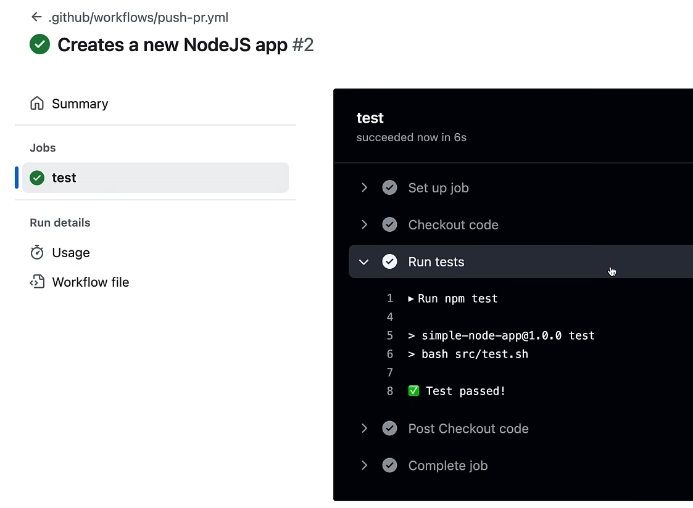

### **Workflow execution**

- If you don’t define dependencies between jobs, the workflow runner will execute all jobs in parallel by default.
- If you want certain jobs to wait for others before running, you can control the execution order by using the `needs` keyword. 
- Within a single job, however, the individual steps always execute one after another, in the order they appear.


```python
on:
  workflow_dispatch:

jobs:
  job_1:
    runs-on: ubuntu-latest
    steps:
      - name: Run job 1
        run: echo "Job ${{ github.job }}" # github.job refer to current job name

  job_2:
    runs-on: ubuntu-latest
    needs: job_1
    steps:
      - name: Run job 2
        run: echo "Job ${{ github.job }}"

  job_3:
    runs-on: ubuntu-latest
    needs: job_1
    steps:
      - name: Run job 3
        run: echo "Job ${{ github.job }}"

  job_4:
    runs-on: ubuntu-latest
    needs: [job_2, job_3]
    steps:
      - name: Run job 4
        run: echo "Job ${{ github.job }}"

```

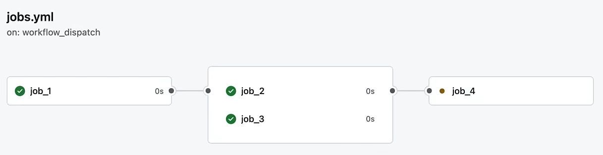

- A runner can be an OS or a docker container whether on GitHub (cloud runner) or in a self hosted runner.
- A Docker container can be used both as a runner and as a GitHub Action, allowing some workflow steps to run inside the container while others run on a virtual machine.
- If the image is in a private repository, it cannot be used as a GitHub Action in a step, but it can be used to run a job as a runner. Using ``secrets``, we can log in to a private Docker registry.


```python
on:
  workflow_dispatch:

jobs:
  hybrid_job:
    runs-on: ubuntu-latest
    steps:
      - name: Run a command in Ubuntu VM
        run: echo "This runs on the Ubuntu VM"

      - name: Run inside an Alpine container
        uses: docker://alpine:3.14  # The image must be accessible without authentication
        with:
          entrypoint: /bin/sh
          args: -c "echo 'This step runs inside an Alpine container'"

      - name: Run another command in Ubuntu VM
        run: echo "Back to the VM"

  dockerized_job:
    runs-on: ubuntu-latest
    container:
      image: ghcr.io/my-org/my-private-image:latest
      credentials:
        username: ${{ secrets.DOCKER_USERNAME }}
        password: ${{ secrets.DOCKER_PASSWORD }}
    steps:
      - name: Show Node.js version
        run: node --version

      - name: Run a command inside the Node.js container
        run: echo "This whole job runs inside a Node.js container"

```

**Note:** 
- Alpine image does not have entrypoint so you need to specify it before running the image.
- Don’t confuse a workflow runner with the type of GitHub hosting service, such as Enterprise Cloud or Enterprise Server. For example, you can use GitHub Enterprise Cloud while running your workflow runners locally.
- Pricing depends on your account type, GitHub hosting option, and usage time. Charges apply only for cloud runners; self-hosted (on-premises) runners are free. For private repositories, fees may apply, while public repositories are completely free.

### **Workflow triggers**
There are three types of triggers :

**Web hooks :** event trigger like push and pull-request...etc.


```python
on:
  watch: # this event is triggered when a repository is starred or unstarred

jobs:
  job_1:
    runs-on: ubuntu-latest
    steps:
      - name: Install dependencies
        run: npm install

      - name: Build project
        run: npm run build
        working-directory: ./temp
        shell: bash

      - name: Print environment
        run: print %ENV
        shell: perl {0} # use other shell than bash
```

**Schedule :** run at specific time using cron job syntax.


```python
on:
  schedule:
    - cron: "0 9 * * *"  # Runs every day at 09:00 UTC

jobs:
  daily-task:
    runs-on: ubuntu-latest
    steps:
      - name: Print message
        run: echo "Running the scheduled task"

```

**Manual :**
- GUI.


```python
on:
  workflow_dispatch:

jobs:
  deploy:
    runs-on: ubuntu-latest
    steps:
      - name: Deploy application
        run: echo "Deploying the application..."
```

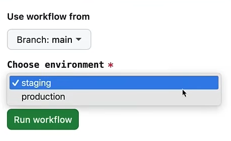

- Github cli.


```python
on:
  workflow_dispatch:
    inputs:
      environment:
        description: "Choose environment"
        required: true
        default: "staging"
        type: choice
        options:
          - staging
          - production

jobs:
  deploy:
    runs-on: ubuntu-latest
    steps:
      - name: Deploy application
        run: echo "Deploying the application to ${{ inputs.environment }}"

```


```python
gh workflow run manual.yml
# Created workflow_dispatch event for manual.yml at main
# To see runs for this workflow, try: gh run list --workflow=manual.yml

gh workflow run manual.yml -f environment=production
# Created workflow_dispatch event for manual.yml at main
# To see runs for this workflow, try: gh run list --workflow=manual.yml
```

- **API Call:** Sends an HTTP request using ``curl`` or any HTTP client, with the workflow execution triggered based on the ``event-type`` specified in the request payload.


```python
on:
  repository_dispatch:
    types: 
      - incident_report

jobs:
  handle-incident:
    runs-on: ubuntu-latest
    steps:
      - name: Print incident details
        run: echo "Incident reported"

```


```python
export GITHUB_PAT= fake-PAT

curl -X POST \
> -H "Authorization: token $GITHUB_PAT" \
> -H "Accept: application/vnd.github.v3+json" \
> https://api.github.com/repos/abohmeed/ghactionscourse/dispatches \
> -d '{"event_type": "incident_report"}'
```

- Using a **PAT** personal access token is recommended for sending HTTP requests to the GitHub API to trigger a workflow.

### **What is an Artifact?**

- An artifact is a file or set of files generated as a result of a build process.
- This can include: compiled binaries or executables, packaged libraries, deployment packages, container images (e.g. a Docker image), configuration files, metadata, documentation, etc.

- Artifacts represent the “product” of translating source code (and resources) into a deployable/runnable form.

- In many development practices — especially where automation is used, such as in Continuous Integration / Continuous Deployment (CI/CD) pipelines — artifacts are the outputs that get passed through testing, staging, and ultimately deployment.

* **Matrix Strategy:** Allows testing an artifact across multiple environments, such as Linux, Windows, and macOS. For lightweight tests, these can be executed within a workflow without requiring a real operating system or physical machine.


```python
on:
  workflow_dispatch:
jobs:
  job_1:
    strategy:
      fail-fast: false
      max-parallel: 3
      matrix:
        os: [ubuntu-latest, windows-latest, macos-latest]
        node_version: [14.x, 15.x, 16.x]
    runs-on: ${{ matrix.os }} # loop over matrix.os array
    steps:
      - name: Set up Node.js
        uses: actions/setup-node@v3.6.0
        with:
          node-version: ${{ matrix.node_version }} # loop over matrix.node_version array
```

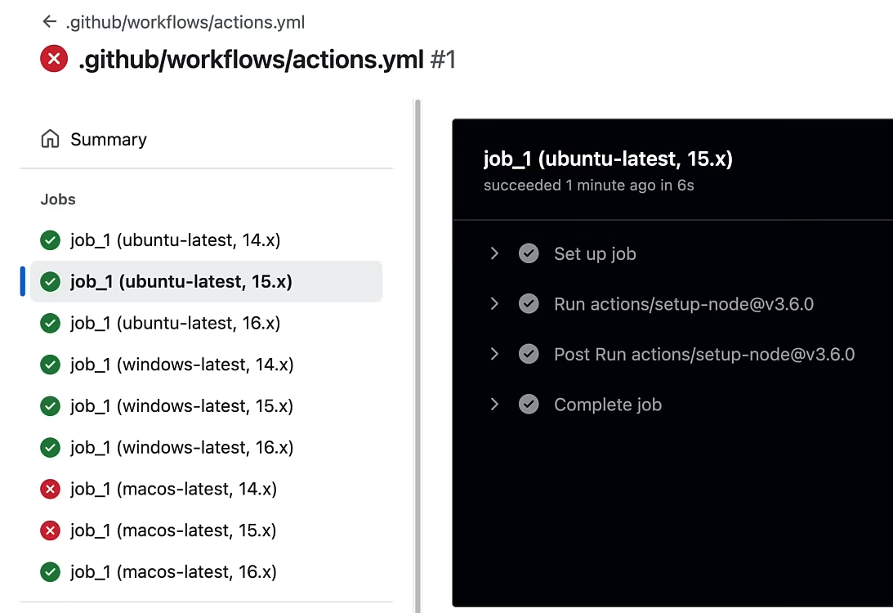

### **Expressions in workflows**


```python
on:
  workflow_dispatch:

jobs:
  expressions:
    runs-on: ubuntu-latest
    steps:
      - name: Print a message
        if: ${{ github.event_name == 'push' && github.ref == 'refs/heads/main' }}
        # if: ${{ contains(github.event.head_commit.message, 'WIP') }}
        # if: ${{ startsWith(github.ref, 'refs/tags/v') }}
        run: echo "The job is running"

# Notes on other conditions:
# contains()    -> checks if a string contains a substring
# startsWith()  -> checks if a string starts with a substring
# endsWith()    -> checks if a string ends with a substring
# always()      -> runs regardless of the previous step result
# cancelled()   -> runs if the previous step was cancelled
# failure()     -> runs if the previous step failed
# success()     -> runs if the previous step succeeded
```

### **Workflows commands** 
- workflow commands comes inside ``::command::``.


```python
on:
  workflow_dispatch:

jobs:
  example:
    runs-on: ubuntu-latest
    steps:
      - name: Check if a file exists
        run: |
          if [ -f "config.yaml" ]; then
            echo "::debug::config.yaml exists"
          else
            echo "::error::config.yaml is missing"
          fi
```


```python
on:
  workflow_dispatch:

jobs:
  example:
    runs-on: ubuntu-latest
    steps:
      - name: Check for deprecated functions
        run: |
          deprecated=true
          if [ "$deprecated" = "true" ]; then
            echo "::warning:: Deprecated function found"
          fi
```


```python
on:
  workflow_dispatch:

jobs:
  example:
    runs-on: ubuntu-latest
    steps:
      - name: Set API key
        run: echo "API_KEY=12345" >> $GITHUB_ENV

      - name: Use API key
        run: |
          echo "::add-mask::$API_KEY"
          echo "Using API key $API_KEY"
```

- The steps in a workflow are independent, each running in its own local scope. To share information from a previous step, you can pass it through environment variables, either via an environment file or the special `$GITHUB_ENV` variable.

## **Git Hooks**
- Git hooks are scripts that run automatically when certain Git events happen locally or on a remote repository.
- Hooks are stored in ``.git/hooks`` inside your repository.
- Git Hooks don't get pushed to GitHub, and they are not version-controlled (unless you have extra setup to distribute them).
- By default, you'll see sample scripts ending with ``.sample``. To enable a hook, remove the ``.sample`` extension and make the script executable.
- Hooks can be written in any scripting language (shell, Python, etc.), as long as the script is executable.


```python
mv .git/hooks/pre-commit.sample .git/hooks/pre-commit
chmod +x .git/hooks/pre-commit
```

### **Types of Hooks**
- Some common predefined hooks are:
    - **pre-commit:** runs before you make a commit.
    - **commit-msg:** checks or edits the commit message.
    - **pre-push:** runs before you push code to a remote.
    - **pre-receive:** run on the Git server, not your computer. These can enforce rules for everyone who pushes to the repository.
- You can have custom hooks


```python
!jupyter nbconvert --to html Git_Explanation.ipynb
```

    [NbConvertApp] Converting notebook Git_Explanation.ipynb to html
    E:\APP_Setup\laragon\bin\python\python-3.13\Lib\site-packages\nbformat\validator.py:434: MissingIDFieldWarning: Cell is missing an id field, this will become a hard error in future nbformat versions. You may want to use `normalize()` on your notebooks before validations (available since nbformat 5.1.4). Previous versions of nbformat are fixing this issue transparently, and will stop doing so in the future.
      _validate(nbdict, ref, version, version_minor, relax_add_props)
    [NbConvertApp] WARNING | Alternative text is missing on 18 image(s).
    [NbConvertApp] Writing 599656 bytes to Git_Explanation.html
    


```python
!jupyter nbconvert --to markdown Git_Explanation.ipynb
```
